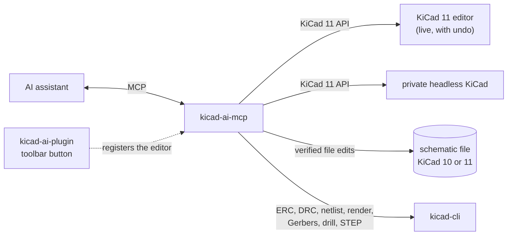

<h1 align="center">thingsvu-tools</h1>

<p align="center">
  <b>AI-assisted design tools for embedded products — schematic, PCB, and enclosure — built on KiCad.</b>
</p>

<p align="center">
  <a href="https://github.com/bkrajendra/thingsvu-tools/releases"></a>
  <a href="https://github.com/bkrajendra/thingsvu-tools/actions/workflows/ci.yml"></a>
  <a href="#project-status"></a>
  <a href="LICENSE"></a>
  
  
  
  
  <a href="https://github.com/sponsors/bkrajendra"></a>
</p>

---

## What is thingsvu-tools?

thingsvu-tools lets an AI assistant work alongside you in KiCad. You describe the circuit you want; the assistant plans the change, shows you exactly what it will do, and — once you approve — builds it in your schematic. Every result is checked against KiCad itself before it is reported back to you.

It connects to any assistant that speaks the [Model Context Protocol](https://modelcontextprotocol.io) (MCP), such as Claude Desktop, Claude Code, or VS Code.

> [!NOTE]
> **Third-party tools.** Whole-board autorouting (`pcb_autoroute_plan`) is done by [Freerouting](https://github.com/freerouting/freerouting), a separate open-source project (GPL-3.0) by its own authors; thingsvu-tools is not affiliated with it. It is optional: it is only used after you set it up (see [Optional: the autorouter](#optional-the-autorouter)), runs on your machine with its network features turned off, and its results are checked by KiCad's own DRC before they are kept. Everything else, including explicit routing, pours, and placement, is done by thingsvu-tools and KiCad itself.

## Why it's different

- **You stay in control.** Changes are proposed as a plan first. Nothing touches your design until you confirm it, and a stale plan is never applied to a document that has changed.
- **Verified, not assumed.** After every change, the tools read the design back from KiCad — symbols, values, and net connections — and run ERC. A check that couldn't run is reported as such, never as a pass.
- **Readable schematics.** Generated schematics read like a person drew them: signal flows left to right, power and ground are symbols, parts are wired, not just labelled.
- **Describe intent, not coordinates.** Say "R1 pin 2 and R2 pin 1 share net MID"; the tools take care of placement, wiring, and labels on the proper grid.
- **Built on KiCad's official API.** First-class support for KiCad 11's schematic API, with a fallback that works on KiCad 10 through the schematic file. You always know which features your KiCad version supports.
- **Works live, headless, or on a file.** Co-edit in the open Schematic Editor with normal undo, generate and verify designs without a GUI, or edit a schematic file with no KiCad running at all.
- **Local and private.** Everything runs on your machine. No cloud service, no open network ports, and your design files stay where they are.
- **Fast and dependable.** Written in Rust as a small set of native binaries — no Python runtime to manage.

## Quick start (Windows)

You need **KiCad 11** (or the 10.99 nightly) for live editing, or **KiCad 10** for the file mode, and an AI assistant that supports MCP. No administrator rights are needed: everything is installed under your user profile.

### 1. Install

**Option A — download.** Get `thingsvu-tools-v<version>-windows-x64.zip` from the [latest release](https://github.com/bkrajendra/thingsvu-tools/releases/latest), extract it, and run `install.ps1` (right-click → **Run with PowerShell**).

**Option B — one line.** In PowerShell:

```powershell
irm https://raw.githubusercontent.com/bkrajendra/thingsvu-tools/main/scripts/install.ps1 | iex
```

This downloads the newest release, checks it against its published checksum, and installs it. Read the [script](scripts/install.ps1) first if you like; it is short.

The installer:

1. puts `kicad-ai-mcp.exe` in `%LOCALAPPDATA%\thingsvu\kicad-ai\bin`;
2. installs the **KiCad AI** plugin into your KiCad 11 plugin folder (`Documents\KiCad\<version>\plugins`) — KiCad 10 cannot run schematic plugins, so it is skipped there;
3. offers to add the server to **Claude Code** and **Claude Desktop** (it keeps a backup of any settings file it changes);
4. offers to add the **pcbparts MCP** (`https://pcbparts.dev/mcp`), the parts-lookup service the assistant uses to fill in part numbers. It is a separate free service; the part values and packages your assistant searches for are sent to it. Claude Code gets it added with `claude mcp add --transport http pcbparts https://pcbparts.dev/mcp`; for Claude Desktop add the same address under Settings → Connectors → Add custom connector;
5. tells you what to do next.

Useful options: `-Yes` (answer yes to everything), `-NoPlugin`, `-SkipClients`, `-NoPartsLookup` (do not offer the pcbparts MCP), `-KicadVersion 11.0`, `-Version 0.1.0`.

### 2. Turn on KiCad's API (KiCad 11, live editing)

In KiCad: **Preferences → Plugins**, enable the **KiCad API**, then restart KiCad. If you only use the file mode, skip this.

### 3. Connect your assistant

The installer does this for Claude Code and Claude Desktop. For anything else, the server is a program that speaks MCP over stdio:

<details>
<summary><b>Claude Code</b></summary>

```powershell
claude mcp add --scope user kicad-ai -- "$env:LOCALAPPDATA\thingsvu\kicad-ai\bin\kicad-ai-mcp.exe"
```
</details>

<details>
<summary><b>Claude Desktop</b></summary>

Add to `%APPDATA%\Claude\claude_desktop_config.json`, then restart Claude Desktop:

```json
{
  "mcpServers": {
    "kicad-ai": {
      "command": "C:\\Users\\<you>\\AppData\\Local\\thingsvu\\kicad-ai\\bin\\kicad-ai-mcp.exe",
      "args": []
    }
  }
}
```
</details>

<details>
<summary><b>VS Code</b></summary>

Add to `.vscode/mcp.json` in your workspace:

```json
{
  "servers": {
    "kicad-ai": {
      "type": "stdio",
      "command": "C:/Users/<you>/AppData/Local/thingsvu/kicad-ai/bin/kicad-ai-mcp.exe"
    }
  }
}
```
</details>

Add `"--read-only"` to the arguments to let the assistant look but never change anything.

### Optional: the autorouter

To let the assistant route a whole board at once, set up [Freerouting](https://github.com/freerouting/freerouting) (a separate open-source program; see the note at the top). One step:

- **Installing now:** answer **y** when the installer asks *"Also set up whole-board autorouting?"*, or run it with `-WithFreerouting`.
- **Already installed:** run this one line in PowerShell:

  ```powershell
  & ([scriptblock]::Create((irm https://raw.githubusercontent.com/bkrajendra/thingsvu-tools/main/scripts/install.ps1))) -FreeroutingOnly
  ```

It uses a Freerouting already on your machine if it finds one that works (a running one, or Freerouting's own Windows install). Otherwise it downloads Freerouting from its official GitHub release: its native command-line build if that works, else its Java build together with a Java 25 runtime (Eclipse Temurin, from Adoptium) when you have none. Every download is checked against its published checksum, and whatever it settles on must route a small test board first. (Freerouting 2.5.0's native Windows build hangs on KiCad boards, so today it ends up with the Java build: about 120 MB with the runtime, a few minutes.) Everything goes under `%LOCALAPPDATA%\thingsvu\kicad-ai`, with a `config.json` there so the server finds it. Restart your assistant afterwards. The uninstaller removes it with everything else.

**Already have Freerouting?** Add `-FreeroutingPath <path to its .exe or .jar>` (and `-JavaPath <java.exe>` for a jar) to the line above; nothing is downloaded. You can also start the server with `--freerouting <path>` (and `--java <path>`), or set `THINGSVU_FREEROUTING`.

Without it, autorouting is simply unavailable and everything else works. Freerouting runs as a separate process for each plan, with its GUI, API server, and usage reporting turned off, so nothing leaves your machine.

### 4. Try it

Ask your assistant:

> Call `session_status` and tell me what KiCad installs and sessions you can see.

Then, with a schematic that is **not** open in KiCad (any KiCad version):

> Open `D:\projects\demo\demo.kicad_sch` with the file provider and build a 3.3 V regulator from 5 V: a fuse, a Schottky diode, an AMS1117-3.3 with decoupling capacitors, and a power LED. Show me the plan first.

Or live, with KiCad 11: open your project in the **Schematic Editor**, press the **KiCad AI: connect** toolbar button (a small dialog confirms), then:

> Open the schematic in my KiCad editor (gui provider) and add an NE555 astable blinker driving an LED.

The assistant plans, shows you the parts, positions, and nets, and waits for your OK. Applying a plan in the live editor is two undo steps (**Ctrl+Z** twice).

To clean up a schematic that already exists:

> Review the schematic, then plan a tidy and show me what would move before you change anything.

The tidy lays the circuit out again, keeping every part, value, and footprint and checking that every net is identical afterwards. It handles a single sheet of parts joined by wires, labels, and power symbols; buses, global labels, and hierarchical sheets are refused with a reason; no-connect flags stay on their pins (drawn again where a part moved), and text notes stay where they are.

To steer it, or to arrange a small circuit yourself:

> Keep J1 where it is and put C1 and C2 next to each other, then tidy.
>
> Move the regulator to the top right, group R1 and R2 below it, then reconnect everything.

To look at a board:

> Open D:/projects/mydesign/mydesign.kicad_pcb, review it, and tell me what the schematic has that the board lacks.

Boards are opened with `pcb_open` (headless needs KiCad 11 or the 10.99 nightly; the file provider also reads KiCad 10 boards for reading, DRC, and render). A board can be brought up to date from its schematic: the assistant shows what KiCad's own netlist import would add, and applies it only after you confirm. New footprints arrive stacked near the origin.

An assistant can then give the board an outline and move parts, through a live session (headless or the PCB editor; a file session only reads):

> Put a 50 x 40 mm outline with 2 mm rounded corners and an M3 hole in each corner around the parts, then turn U1 by 90 degrees and move C1 to the back.

Each change is shown as a plan first, applied as one step (one Ctrl+Z in the editor), and read back: the outline, and every moved footprint's place, turn, side, lock, pads, and nets, with KiCad's DRC run before and after. A change that fails those checks, or makes DRC worse, is undone automatically and the board is read again to confirm it is as it was. Locked footprints stay where they are unless you say otherwise.

Once the board has an outline, the assistant can place every part:

> Place the parts on the board. Keep J1 on the left edge and put the LED near the connector.

The main IC goes in the middle, connectors on an edge, decoupling capacitors beside the pins they serve, and everything else near what it connects to, with no overlaps; parts you drew a box around on the schematic stay together. The plan shows the measured result before and after (wire length, overlaps, distances) so you can judge it, and individual parts can be adjusted afterwards with a move.

Tracks are planned the same way:

> Route VBUS from J1 to the fuse, then run +3V3 from U1 pin 2 to C3 on the top layer, dropping to the bottom layer through a via at 112, 90.

Between two pads the assistant finds a simple path (straight, 45°, or an L) on a layer both pads are on; with more points it follows them, placing a via wherever the layer changes. Widths, clearances, and via sizes come from your board's net classes. Every track and via is checked against other nets' copper and the board edge before anything changes, and DRC runs before and after applying, so you see the unrouted count drop and any new error. Copper pours too:

> Pour ground on both layers, with thermal reliefs, and tell me which connections are still missing.

The pour covers the board (or an area you give) at your net class's clearance; the plan lists the pads it should connect, applying refills it and runs DRC before and after.

With Freerouting set up ([one step](#optional-the-autorouter)), the whole board can be routed at once:

> Autoroute the board and tell me if anything is left.

The plan runs Freerouting on a snapshot of the board and shows its result (unrouted connections, tracks per net, the unlocked tracks it would replace) before anything changes; applying imports it into KiCad and checks that no part moved and DRC is no worse. Lock the tracks you want to keep.

When the board is done, the assistant makes the files to order it:

> Check the board and make a JLCPCB package.

Before anything is written, the board is checked: the outline is closed, DRC has no errors and nothing is unrouted, every footprint has a BOM line, and the silkscreen stays on the board. If a check fails, you see why and nothing is written, unless you say to go ahead anyway; that decision is recorded in a checks report beside the files. `pcb_fab_package` then writes, into a `fab` folder next to the board, the Gerbers and drill files as one zip (what you upload for the bare board), the BOM and placement (CPL) files in JLCPCB's columns, and one `<board>-fab.zip` with all of it. `pcb_export` writes the pieces separately (Gerbers, drill, positions, STEP, PDF or SVG plots). Every file is read back before it is kept: the copper layer count, the outline, every drill hole against the board's holes, the placement rows against the parts, and, with KiCad 11, every Gerber through the same reader KiCad's Gerber viewer uses. Nothing is uploaded.

For an enclosure, ask for the board's mechanical summary:

> What are the board's size and mounting holes, which edge does the USB connector face, and how tall is the tallest part?

`pcb_mechanical_info` returns the outline and thickness, mounting holes, keep-out areas, connectors and the edge each one faces, and each part's height. A height comes from the part's `Height` field, or else from a typical height for its package, marked as an estimate.

To get a schematic ready to order parts:

> Review the BOM for a JLCPCB order. Look up the parts you can, fill in the part numbers, assign the missing footprints, and export the BOM.

The server makes no network calls itself. `bom_review` lists what is missing; `parts_lookup` turns those lines into the exact calls to make on the **pcbparts MCP** (JLCPCB, Mouser and DigiKey parts, stock and prices, no key needed): a search such as `jlc_search` with the value and package of each line, or `jlc_get_part` for a part number you already have. The assistant makes those calls and records the answers with `sch_set_fields_plan` (fields `MPN`, `Manufacturer`, `LCSC`). The pcbparts MCP is a separate service run by someone else, and the values and packages searched for are sent to it; the installer asks whether to add it (see [Install](#1-install)). Without it the fields stay empty and the review keeps saying so. If thingsvu-tools gets its own parts data later, `parts_lookup` will answer itself and nothing about the workflow changes.

After a tidy or a reconnect, KiCad decides where the text of each part lands, and it can run into a wire or another part's text. Ask for it to be cleaned up:

> Check the schematic for text that overlaps, and move it.

Labels, notes, and drawings can be edited too:

> Put a box around U1, C1 and C2 titled "Regulator", and add a label OUT on R3 pin 2.

Moving, turning, or deleting a part leaves its wires behind, so the circuit is broken until you ask for **reconnect**, which draws every connection again around the parts where they now are (and checks every net against KiCad). Good for the start of a design and for small circuits; for a whole sheet use the tidy.

## Three ways to work

| Provider | KiCad | What it does | Choose it when |
|---|---|---|---|
| `gui` | 11 | Edits the schematic open in your editor, live, with undo | You want to co-edit and watch it happen |
| `headless` | 11 | Starts a private KiCad in the background and works on a file | You want to generate or check designs without a GUI |
| `file` | 10 or 11 | Edits the `.kicad_sch` file itself; every change is verified with `kicad-cli` in a copy before it replaces the file | You use KiCad 10, or want no KiCad running. The file must not be open in an editor |

What each can do in detail: [capability matrix](docs/capability-matrix.md).

## Tools

| Tool | What it does |
|---|---|
| `session_status` | KiCad installs found, open sessions, what each can do, and whether the autorouter is set up |
| `session_open` / `session_close` / `session_reload` | Open a schematic (or create one), close it again, or read it from its file again after the file changed or to drop changes (refuses with unsaved changes unless told, and lists what would be lost). `read_only: true` opens a file an editor has locked, for reading only. `session_status` says whether the file changed on disk since the session read it |
| `session_list_documents` | Documents open in the session's KiCad |
| `sch_list_symbols` / `sch_get_symbol_pins` | Read parts and their pins, positions, and types |
| `sch_get_netlist` | Connectivity as KiCad's netlister sees it |
| `sch_plan_changes` | Turn a circuit (parts and nets) into an exact, reviewable plan: parts with their fields, nets, `no_connects` on unused pins, and `power_flags` on nets a power input needs driven. Changes nothing |
| `sch_apply_plan` | Apply a plan you confirmed (new circuit or tidy), verify it against KiCad, and report any difference |
| `sch_review` | Look at an existing schematic: overlapping parts, wires through parts, and whether it can be tidied. Read-only |
| `sch_tidy_plan` | Plan a cleaner layout for an existing schematic: parts re-laid out, old wires and labels replaced, nets kept identical. Optional hints: `keep`, `place`, `near`. Changes nothing until applied |
| `sch_describe_layout` | Where every part and pin is (mm), its rotation and body, and the net of each pin. Read-only |
| `sch_arrange_plan` | Plan moving, turning, mirroring, or deleting named parts. Their wires stay and break until reconnected |
| `sch_page_plan` | Page size (A5 to A0, ANSI, US, or custom) and orientation, and the title block: title, date, revision, company, comments 1 to 9. Nothing else on the sheet changes; warns when parts would end up off a smaller page |
| `sch_pin_net_plan` | Move one pin to another net, or swap the nets of two pins, changing only those pins' wire, label, or power symbol (a short stub that names the new net); every net is read back from KiCad |
| `sch_reconnect_plan` | Plan drawing all connections again with the parts where they are, for the circuit as it was before the moves |
| `sch_declutter_plan` | Find text (part references and values, labels) that runs into other text, a wire, or a part, and plan moving it to a free place; `PWR_FLAG` text that has no room is hidden. Only text changes |
| `sch_label_plan` | Add, rename, turn, or delete net labels. Refuses a label that would give a net a second name or join two nets by accident |
| `sch_draw_plan` | Draw rectangles, circles, lines, text notes, and a titled box around named parts (for example "Power supply") |
| `sch_edit_items_plan` | Delete wires, labels, junctions, notes, and drawings by id, or move labels, notes, and drawings |
| `bom_get` | The bill of materials as KiCad groups it, with every custom field. Read-only |
| `bom_review` | What an order lacks: footprints, part numbers, supplier numbers, inconsistent values; plus a list of lookups to do. No network |
| `parts_lookup` | The lookups as calls to make on the pcbparts MCP (search by value and package, or by part number) and the fields to record afterwards. Makes no call itself; read-only |
| `sch_set_fields_plan` | Set fields on many parts at once: part numbers, manufacturer, datasheet, DNP, exclude from BOM (custom fields are added hidden) |
| `sym_search` / `sym_get` | Search the symbol libraries by name, keyword, or description (default footprint and filters, pins, units) and read one symbol's pins without placing it |
| `fp_search` / `fp_get` | Search the footprint libraries and read a footprint's pads and courtyard |
| `sch_footprint_plan` | Check every footprint (missing, not in the libraries, no pad for a pin, wrong package) and assign footprints |
| `bom_export` | Write the BOM as CSV into the project folder (generic or JLCPCB columns) |
| `pcb_open` / `pcb_close` / `pcb_save` / `pcb_reload` | Open a board (headless, file, or the PCB editor; `read_only: true` for a file session on a board an editor has open), close it, save it, or read it from its file again (`pcb_info` says when the file changed on disk or the board has unsaved changes; a reload with unsaved changes lists what it would lose and needs `discard_unsaved`) |
| `pcb_info` / `pcb_list_footprints` / `pcb_get_footprint` / `pcb_list_nets` / `pcb_list_tracks` | Read the board: counts, outline, footprints with pads and courtyards, nets, tracks, vias, zones. `detail: full` (with `references` to narrow it) adds each pad's shape, size, drill, and turn, the courtyard outline, and the footprint's text and fields with layer, size, place, and visibility |
| `pcb_list_drawings` | The drawings and text on the board itself (not in footprints): lines, rectangles, circles, arcs, polygons, and text, with layer, points, line width, fill, and lock; narrowed by layers and kinds |
| `pcb_run_drc` / `pcb_render` | Design rules check (zones refilled first; counts by type, with `summary_only`, `severity`, `types`, and `limit` to keep a big board readable; unrouted connections) and a 3D picture of the board |
| `pcb_review` | What stands out: overlaps, parts outside the outline, no outline, schematic and board that disagree, far connectors and decoupling capacitors, DRC |
| `pcb_update_from_schematic_plan` / `pcb_apply_plan` | Update the board from its schematic: a dry run first, then apply after you confirm; every footprint and pad net is checked afterwards |
| `pcb_outline_plan` | A board outline (rectangle, rounded corners) of a given size or fitted around the parts, with mounting holes in the corners or at given places; applied with `pcb_apply_plan` |
| `pcb_footprint_attrs_plan` | Set do-not-populate, BOM, position-file, and board-only attributes on named footprints, or on every mounting hole (repairs holes from boards made with v0.7.0); applied with `pcb_apply_plan`, read back |
| `pcb_move_plan` | Move, turn, flip, and lock named footprints (places on a grid, exact offsets); shows overlaps before and after; applied with `pcb_apply_plan`, every pad read back |
| `pcb_route_plan` | Tracks and vias for named nets, pad to pad or through given points, at the net class width (`locked: true` locks what a route makes); checked against other nets' copper and the edge; DRC before and after applying |
| `pcb_rules` / `pcb_rules_plan` | Read the design rules (net classes and the nets in each, minimums, mask and paste margins, stackup) and change them: create or change net classes (track width, clearance, via size and drill, differential pair), assign nets by name or pattern, set the board minimums. Applied with `pcb_apply_plan` and read back; in a live session through the API, with no editor through the project file (checked by `kicad-cli`, backup kept) |
| `checkpoint_create` / `checkpoint_list` / `checkpoint_diff` / `checkpoint_restore` | Keep copies of the project's board, schematic, and project file in `.thingsvu/checkpoints/` (a live session's unsaved changes included), list them, compare one with another or with the project now by meaning (parts, nets, tracks, zones, rules), and put one back. A restore refuses over unsaved changes, takes a checkpoint of the present first, and reloads the sessions. `pcb_apply_plan` takes `checkpoint: label` to keep one first |
| `pcb_track_edit_plan` | Edit copper already on the board: delete (rip up) tracks and vias by net, layer, area, or id, give tracks a new width, lock and unlock, and clean up dangling vias, zero-length and duplicate tracks. Locked items are skipped unless named; the plan lists every item and a count per net; applied with `pcb_apply_plan` (one change, read back, DRC before and after) |
| `pcb_zone_plan` | Copper pours (ground first) over the board or an area, with clearance, minimum width, and thermal reliefs; refilled after applying, DRC before and after |
| `pcb_autoroute_plan` | Route the board with Freerouting (optional, when configured), all nets or only some (`nets`, `exclude_nets`), keeping what is drawn (`keep_existing`, default) or ripping up the unlocked tracks of the nets it routes (`keep_existing: false`); net classes give nets their widths; the time limit ends the router and everything it started: the router's result first (wires narrower than the board's minimum are widened), then KiCad's import, dangling vias removed, checked with DRC before and after |
| `pcb_export` | Gerbers, drill, positions, STEP, PDF/SVG plots, and the mechanical model, into the project, after the pre-export checks; every file read back |
| `pcb_fab_package` | The files a board house needs (Gerber zip, BOM, CPL; JLCPCB or generic columns) and one zip with all of them and the checks report |
| `pcb_mechanical_info` | Outline, thickness, mounting holes, keep-outs, connectors and the edge each faces, and part heights, for enclosure design. Read-only |
| `pcb_place_plan` | Place the footprints inside the outline (main IC central, connectors on edges, decoupling beside its pins, no overlaps), with hints keep, place, near, edge, groups, side, only; measured before and after; applied with `pcb_apply_plan` |
| `sch_set_field` | Change one part's value or footprint |
| `sch_save` | Save the schematic |
| `sch_run_erc` | Electrical rules check |
| `sch_export_netlist` | Write a KiCad netlist |
| `sch_render` | A PNG of the schematic, so the layout can be checked visually |
| `sch_create_demo_circuit` | A two-resistor demo for a quick end-to-end check |

## Troubleshooting

| Problem | What to do |
|---|---|
| No **KiCad AI: connect** button | Restart KiCad after installing. The plugin must be in `Documents\KiCad\<version>\plugins\com.thingsvu.kicad-ai` (your Documents folder may be redirected, e.g. to OneDrive; the installer handles that). It needs KiCad 11 or the 10.99 nightly, and the button appears in the Schematic Editor |
| `session_status` shows no editors | Enable the KiCad API in Preferences → Plugins, restart KiCad, then press the button again |
| `DOCUMENT_OPEN_ELSEWHERE` | The file is open in a KiCad editor. Use the `gui` provider for that editor, or close it before using `file` or `headless` |
| `STALE_PLAN` | The schematic changed after the plan was made. Ask for a new plan |
| `FEATURE_UNAVAILABLE` for rendering | KiCad 10's `kicad-cli` cannot export PNG. Install KiCad 11 (or the 10.99 nightly) next to it |
| "format version … is older" | Open and save the file once in KiCad 10, or run `kicad-cli sch upgrade <file>`, then try again |
| A symbol is not found | Symbols come from the schematic itself, the project's `sym-lib-table`, and KiCad's standard libraries. Libraries only in your global library table are not read yet |
| `file_changed_on_disk: true` in `pcb_info` or `session_status` | Something else changed the file after the session read it. Ask for a reload (`pcb_reload` or `session_reload`); with unsaved changes it lists what would be lost and waits for `discard_unsaved` |
| `.thingsvu` folder in my project | The checkpoints (`checkpoint_create`, and any plan applied with `checkpoint`). They are plain folders you can delete; add `.thingsvu/` to `.gitignore` if the project is under version control |
| `KICAD_BUSY` | KiCad did not answer in time (the first netlist import or a big refill can be slow). Ask again; nothing was changed (`mutation_state` says so) |
| Autorouting does not finish | The time limit ends the router and everything it started and says so; give a longer `time_limit_s` or fewer `passes`, or route only some nets (`nets`) |
| Windows SmartScreen warning | The binaries are not code-signed yet. Compare the file's SHA-256 with `SHA256SUMS.txt` on the release page |
| Something else | Logs are in `%LOCALAPPDATA%\thingsvu\kicad-ai\logs` (the last 7 days). Run `kicad-ai-mcp --help` for options |

## Updating and removing

- **Update:** run the installer again (a newer release replaces the old files). Close your assistant first if it holds the server open.
- **Remove:** run `%LOCALAPPDATA%\thingsvu\kicad-ai\uninstall.ps1`. It removes the server, the plugin, registrations, logs, and the assistant entries the installer added, and nothing else. Your schematics and KiCad's own settings are never touched.

## What's included

| Component | What it does |
|---|---|
| **kicad-ai-mcp** | The MCP server your AI assistant talks to |
| **kicad-ai-plugin** | A KiCad plugin that makes your open editor available to the assistant |
| **kicad-domain** | The shared circuit model: plans, validation, layout, and readability checks |
| **kicad-session**, **kicad-ipc**, **kicad-sexpr**, **kicad-cli-runner** | Sessions over KiCad's API or a schematic file; the API client; KiCad file reading and writing; `kicad-cli` jobs |
| **mech-model** | A neutral description of the board for mechanical design (no KiCad types), the start of the enclosure tools |



More detail: [architecture](docs/architecture.md).

## Build from source

You need [Rust](https://rustup.rs) (stable) and [`protoc`](https://github.com/protocolbuffers/protobuf/releases) on your `PATH`.

```powershell
cargo build --release -p kicad-ai-mcp -p kicad-ai-plugin
cargo test --workspace                         # no KiCad needed
$env:KICAD_LIVE = '1'; cargo test --workspace -- --test-threads=1   # against your KiCad installs
.\scripts\package.ps1                           # release zip, PCM zip, checksums in .\dist
.\scripts\install-plugin.ps1                    # developers: just the plugin, from your build
```

How releases are made: [releasing](docs/releasing.md).

## Roadmap

- **Now:** schematic inspection and editing, readable generated schematics (signal flow left to right, power symbols, wires), reviewing and tidying existing schematics, ERC, netlist export, verified demo circuits, KiCad 10 through the schematic file, and a one-step installer
- **Now (also):** parts, footprints, and BOM review and export
- **Now (also):** reading, DRC, rendering, and reviewing boards, and updating a board from its schematic
- **Now (also):** board outline, placement, routing, pours, and autorouting (optional, with Freerouting)
- **Now (also):** manufacturing outputs (Gerbers, drill, BOM and placement files, STEP) with checks before export, and a mechanical summary of the board
- **Now (also):** editing the board without touching files: ripping up, re-widening, and locking tracks, net classes and design rules, full footprint geometry, reloading a board or schematic that changed on disk, checkpoints you can diff and restore, no-connect flags, power flags, pin swaps, and symbol search, and control over what the autorouter routes and keeps
- **Next (Phases 15 and 16, see [docs/workflow-gaps-plan.md](docs/workflow-gaps-plan.md)):** page size and title block, footprint edits and updates from the library, silkscreen checks, stitching vias and connectivity checks, copper pours on both layers
- **Also open:** hierarchical schematics
- **Later:** 3D enclosure design driven from your PCB, so the whole embedded product comes together in one workflow

## Project status

thingsvu-tools is in early development and is not ready for production designs yet. The architecture and plan are in [`docs/`](docs/README.md).

AI-generated designs do not replace qualified engineering review. Always review and verify a design before manufacturing it.

## Supported KiCad versions

| KiCad | Support |
|---|---|
| 11 (currently nightly 10.99) | First-class: full schematic editing, live and headless |
| 10.0.x | Fallback through the schematic file: inspection, ERC, netlist, and editing of schematics no editor has open (each change is checked with `kicad-cli` before it replaces the file) |

## Sponsor

If thingsvu-tools is useful to you, please consider [sponsoring its development](https://github.com/sponsors/bkrajendra). Sponsorship helps keep the project independent and moving forward.

## License

thingsvu-tools is free software, licensed under the [GNU General Public License v3.0 or later](LICENSE). thingsvu-tools is an independent project and is not affiliated with or endorsed by the KiCad project.
