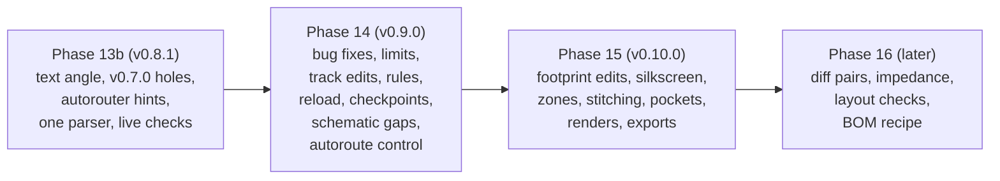

# Plan: closing the gaps found in a full board session (Phases 14 to 16)

Status: Phase 13b (v0.8.1) done on 31 Oct 2026; Phase 14 (v0.9.0) done on 1 Nov 2026 (14.0 to 14.9: API probe, fixes, track edits, full geometry, reload, checkpoints, schematic gaps, autoroute control); Phases 15 and 16 planned (written 27 Oct 2026, after v0.8.0). The task lists are in [tasks.md](tasks.md), Phases 13b and 14 to 16. This page holds the reasoning: what was missing, what already exists, what to build first, and the decisions that need the project owner's review.

## Where this comes from

An assistant took an ESP32-S3 base board from an empty schematic to a manufacturing package in one session, before v0.8.0. It worked, but for many steps it could not use thingsvu-tools and fell back to editing `.kicad_pcb`, `.kicad_sch`, and `.kicad_pro` with Python or `sed`, or to running `kicad-cli` itself. Each such edit skips the plan, confirm, and verify steps that make the tools safe, so every fallback is a gap worth closing. Afterwards the assistant listed 31 gaps (numbered #1 to #31 below, in the order it gave them, roughly by the time each cost).

## What already exists (or arrived in v0.8.0)

Some gaps are covered, partly or fully, by tools the session did not use or that came later. These need no new tool, only better tool descriptions (so an assistant finds them) or a small extension:

| Gap | Covered by | What is still missing |
|---|---|---|
| #15 Fab files and the JLCPCB format | `pcb_fab_package` and `pcb_export` (v0.8.0): Gerbers, drill, BOM, CPL in JLCPCB columns, one zip, checks first | A PCBWay preset |
| #18 STEP | `pcb_export` `step` (v0.8.0) | IPC-2581, ODB++, a board netlist (IPC-D-356) |
| #16 Bottom 3D view and 2D layers | `pcb_render` already takes `side: bottom`; `pcb_export` `svg` writes one SVG per layer (v0.8.0) | A perspective or angled view, zoom; a schematic render cropped to the parts |
| #1 Multi-point tracks and vias | `pcb_route_plan` takes any number of points with layers and puts vias where the layer changes | Deleting, locking, width changes, clean-up (a new tool) |
| #11 Part numbers on parts | `sch_set_fields_plan` sets fields on placed parts | **A bug**: `fields` given to `sch_plan_changes` are accepted and silently dropped (`ComponentSpec.fields` never reaches the plan). Fix in 14.1 |
| #30 Resolving the whole BOM | `bom_review` lists every lookup to do; `sch_set_fields_plan` records the answers in one plan | By design the server makes no network calls (see W1); the lookups stay with the assistant's parts tool |
| #6 Board geometry | `pcb_list_footprints` with `include_pads` gives place, rotation, courtyard box, every pad's place, copper box, net, and layers | Pad size, shape, drill, and angle; courtyard outlines; drawings and text. Extend the tool (14.4) |
| #20 Narrow autorouted tracks | `pcb_autoroute_plan` already warns when tracks are narrower than the board minimum | It should not produce them: give the router the minimum, or widen and recheck (14.1) |

Not ours, and left out:
- **#23**: the separate Freerouting MCP server is another project.
- **#31**: the "1M resistor" that came back as 1 mΩ is a bug in a third-party parts-search server, so it should be reported to that server's maintainers.

## What KiCad 11 offers for the rest

The vendored API (KiCad 10.99) has calls for most of the missing board and session tools. They are in the protos, not yet probed: some may be unhandled, as `GetBoundingBox` was for schematics, so Phase 14 starts with a probe (14.0).

| Need | API calls |
|---|---|
| Net classes, assignments, design rules, custom rules, stackup (#3) | `GetNetClasses` / `SetNetClasses`, `GetNetClassAssignments` / `SetNetClassAssignments`, `GetBoardDesignRules` / `SetBoardDesignRules`, `GetCustomDesignRules` / `SetCustomDesignRules`, `GetBoardStackup` / `UpdateBoardStackup` |
| A stale or externally edited document (#24, #25) | `GetDocumentModifiedState`, `RevertDocument` (reloads from disk, losing unsaved changes), `RefreshEditor` |
| Page size and title block (#10) | `GetPageSettings` / `SetPageSettings`, `GetTitleBlockInfo` / `SetTitleBlockInfo` |
| Isolated copper and connectivity (#27, #4 islands) | `GetConnectedItems`, `GetItemsByNet`, filled zone polygons from `GetItems` |
| Real text extents for silkscreen (#5) | `GetTextExtents`, `GetTextAsShapes` (replaces the 0.8-per-letter estimate of Phase 13) |
| Exact pad shapes for clearance (#4 stitching, #6) | `GetPadShapeAsPolygon` |
| Footprint from the library again (#2) | `GetItemsFromLibrary` plus `UpdateItems`, as for mounting holes in Phase 12; no single "update from library" call, so the tool keeps the place, side, reference, value, fields, and pad nets, and replaces the rest |

`kicad-cli` adds `pcb drc --refill-zones` (#21), `pcb export ipc2581`, `odb`, and `ipcd356` (#18), and `pcb render` with `--perspective`, `--rotate`, and `--zoom` (#16).

## Every candidate tool, prioritised

Priority comes from the time each gap cost, how often a board needs it, and how risky the fallback is (hand-editing a board file the editor has open is the riskiest). **P1** is Phase 14, **P2** Phase 15, **P3** Phase 16 or later. The effort column is S (days), M (about a week), or L (more).

| # | Tool or change | Gaps | Priority | Effort | Notes |
|---|---|---|---|---|---|
| 1 | Fix: `sch_plan_changes` writes `fields` (or refuses them) | #11 | P1 | S | Silent data loss; the BOM came out empty |
| 2 | Fix: DRC summaries, not floods: `pcb_run_drc` with `summary_only`, `severity`, `types`, `limit`; every apply returns counts by type and only what changed | #17 | P1 | S | The full list flooded the assistant's context on every apply |
| 3 | Fix: DRC after an apply refills zones first (`--refill-zones` on the snapshot) | #21 | P1 | S | Stale pours made hundreds of false errors after autorouting |
| 4 | Fix: autoroute respects the board minimum width (DSN rules from the net classes and minimums; recheck and refuse) and removes dangling vias after import | #20 | P1 | S | |
| 5 | Fix: limits. Circuit plans up to 150 parts, tidy up to 150 parts; power flags not counted as parts; no-connect flags kept by the tidy instead of refused | #13, #14 | P1 | M | See W2 |
| 6 | `pcb_track_edit_plan`: delete tracks and vias by net, area, layer, or id; change width; lock and unlock; clean up dangling vias and zero-length or duplicate tracks. Plus `locked` on `pcb_route_plan` | #1 | P1 | M | The biggest gap |
| 7 | `pcb_rules_plan`: net classes (width, clearance, via sizes, diff pair), net-to-class assignments (names and patterns), board minimums (track, via, hole, edge clearance), solder mask and paste margins; stackup read | #3 | P1 | M | API first; `.kicad_pro` edited by the file provider only when no live session (W4) |
| 8 | Session freshness: `session_status` and `pcb_info` say whether the editor's copy differs from the file on disk; `pcb_reload` / `session_reload` (headless reopens; gui reverts only with `discard_unsaved: true`); file provider `read_only: true` ignores lock files | #24, #25 | P1 | M | See W3 |
| 9 | Checkpoints: `checkpoint_create`, `checkpoint_list`, `checkpoint_diff` (semantic: parts, nets, tracks, zones, rules), `checkpoint_restore` for the project's board, schematic, and project files | #26 | P1 | M | Copies in `.thingsvu/checkpoints/` in the project; restore refuses while an editor has unsaved changes |
| 10 | Schematic circuit plans: `no_connects` (pin list) and power flags on a named net, placed at the net | #7, #8 | P1 | S | |
| 11 | `sch_pin_net_plan`: move one pin to another net (or swap two pins' nets), redrawing only that pin's wire and label | #9 | P1 | M | Uses the reconnect router for one pin |
| 12 | `sym_search` / `sym_get`: symbols in the libraries by name, keywords, and description; a symbol's pins, units, default footprint, and footprint filters, without placing it | #12 | P1 | S | `fp_search` / `fp_get` already do this for footprints |
| 13 | `pcb_list_footprints` `detail: full` (pad size, shape, drill, angle, courtyard outline, fields and text), and `pcb_list_drawings` (board drawings and text) | #6 | P1 | S | |
| 14 | `sch_page_plan`: page size (A4 to A0, custom), title block fields | #10 | P2 | S | API on 11, file text on 10 |
| 15 | `pcb_footprint_edit_plan`: pad drill and size, a pad's zone connection; reference and value text layer, size, place, visibility | #2, #4 | P2 | M | |
| 16 | `pcb_footprint_update_plan`: replace footprints from the library (one, or every `lib_footprint_mismatch`), keeping place, side, fields, and nets | #2 | P2 | M | |
| 17 | `pcb_silk_plan`: board text (header pin labels, version, logo text) on silkscreen or copper; and a silkscreen tidy that moves overlapping or off-board references using KiCad's real text extents | #5 | P2 | M | Also fixes the J1 warning seen in Phase 13 |
| 18 | Zones: per-pad connection overrides; islands reported after every refill (and removable); `pcb_stitch_plan` for a grid or edge row of ground vias clear of pads, tracks, and edges | #4 | P2 | M | |
| 19 | `pcb_connectivity`: for each net, its isolated pockets and the pads, tracks, vias, and zone pieces in each | #27 | P2 | M | Found the USB-C ground pocket by guessing |
| 20 | Autoroute control: `nets` (route only these), `exclude_nets`, `keep_existing` (hand-routed tracks stay fixed), per-net width through net classes in the DSN; a time limit that always ends the process | #19, #22 | P1 (moved up, W6) | M | #22: check the timeout kills the whole process tree. Task 14.8 |
| 21 | Renders: `pcb_render` `view: perspective`, `rotate`, `zoom`; `sch_render` cropped to the parts, with `width` or `zoom`, from a snapshot when the file is locked | #16 | P2 | S | |
| 22 | Exports: `ipc2581`, `odb`, `netlist` (IPC-D-356) in `pcb_export`; a `pcbway` preset in `pcb_fab_package` | #15, #18 | P2 | S | |
| 23 | Differential pairs: route a pair together at the class gap, report length mismatch; length matching by meanders | #28 | P3 | L | Freerouting can route pairs given the classes; doing it ourselves is large |
| 24 | Impedance: a trace width and gap calculator from the stackup (microstrip and stripline formulas), checked against a net class target | #28 | P3 | M | Approximate formulas, said so in every result |
| 25 | Layout checks: return path under signals (ground plane gaps), stitching density near the edge and layer changes, power track width against a current the user gives (IPC-2152) | #29 | P3 | M | Findings to look at, as `pcb_review` |
| 26 | Whole-BOM resolution recipe: `bom_review` gives the lookups as one batch an assistant can hand to its parts tool, and `sch_set_fields_plan` takes the answers in one plan | #30 | P3 | S | Mostly documentation; no network in the server (W1) |

## Fixes carried over from earlier phases (Phase 13b)

Not from the ESP32-S3 list: open items from Phases 9 to 13 that the project owner chose to fix first. Each is small, and none depends on the Phase 14 tools.

| | Item | Why now | Priority | Effort |
|---|---|---|---|---|
| B1 | Text follows a turned part (task 9.9): fields turn with the part, as KiCad's rotate does, and stay readable | Every tidy of a circuit with turned parts leaves text the wrong way round, and the declutter measures it wrongly | P0 | S |
| B2 | Mounting holes from v0.7.0: a review and export warning, and `pcb_footprint_attrs_plan` (`dnp`, BOM, position file, board-only; `mounting_holes: true` for all holes) | Existing boards list their holes as parts to place in the position file; hand-editing is the fallback Phase 14 is meant to remove | P0 | S |
| B3 | The autorouter does the hard routing: tool descriptions, refusals, and DRC and review results point to `pcb_autoroute_plan`; `session_status` says whether it is configured | An assistant that does not know a router exists tries to build long routes track by track | P0 | S |
| B4 | One s-expression parser for the CLI runner and `kicad-sexpr` (7.11, 9.8) | Two parsers drift apart; Phase 14's checkpoint diff and `.kicad_pro` work read more files | P0 | S |
| B5 | Live checks: export from the PCB editor, undo steps of the netlist import and the autorouter import | Written as "not tried" in three phases' known limits | P0 | S |

Left where they are, and why:
- **A router of our own**: no. Freerouting does the complex routing (W6); `pcb_route_plan` stays an explicit-track tool and its path finder is not extended. Phase 14 makes the autorouter easier to steer (row 20) instead.
- **Text placement on the board (silkscreen)**: already row 17 (Phase 15).
- **KiCad 10 board editing (12.9)**: only if asked. **Hierarchical sheets, global labels, multi-unit symbols**, boxes that follow their parts, the two unexplained tidy removals, and the re-pin to KiCad 11.0: not scheduled, as before.

## Phases

**Phase 13b (v0.8.1): fixes carried over** (B1 to B5). Small and independent; done first so that Phase 14 starts from a clean base. Exit: a tidy keeps text readable on turned parts, v0.7.0 holes can be repaired and are warned about, the routing tools point to the autorouter, and the runner and `kicad-sexpr` share a parser.

**Phase 14 (v0.9.0): fix what broke, and edit without touching files** (rows 1 to 13 and 20). First the bugs and limits that cost the most time or lost data, then the four tools whose absence forced file edits most often: track editing, design rules, session freshness, and checkpoints, then the small schematic tools. Exit: the ESP32-S3 session's file-edit steps (rip-up, locks, net classes, no-connects, pin swap, reload, backups) can each be done with a tool, with no `.kicad_*` file opened by the assistant.

**Phase 15 (v0.10.0): finishing a board** (rows 14 to 19 and 21 to 22): footprint and pad edits, footprints updated from the library, silkscreen text and tidy, zone details, stitching, connectivity pockets, renders, more exports. Exit: a board with a ground pour on both layers, stitching, a silkscreen without overlaps, and a USB connector updated from the library, produced and checked with tools only.

**Phase 16 (later): signal integrity and layout checks** (rows 23 to 26). Each is larger and more approximate, so each is planned on its own once Phases 14 and 15 are in use.

## Decisions for the project owner's review

| | Decision | Proposal |
|---|---|---|
| W1 | Parts lookups in the server (#30) | **No.** The server stays offline. `bom_review` gives the lookups; the assistant's parts tool answers them; `sch_set_fields_plan` records the answers. Revisit only if a parts source with a stable, keyless API appears |
| W2 | Larger plans and tidies (#13, #14) | Raise the limit to 150 parts, measured first. The layout engine's run time and readability on large sheets are not known yet, so 14.1 measures a 150-part circuit and lowers the limit if it is slow or unreadable. Above the limit the answer is to split the circuit (sheets come later) |
| W3 | Reverting a live editor (#24) | `RevertDocument` throws away unsaved changes, so it runs only with `discard_unsaved: true` and after the user has been told what they lose (the tool reports the modified state first). Headless sessions simply reopen |
| W4 | Editing `.kicad_pro` directly (#3) | Through the API in live sessions. With the file provider (no editor open), edit only the JSON keys the tool owns (net classes, assignments, rules), keep everything else byte for byte, and check the result by running DRC with `kicad-cli` before replacing the file, as schematics are |
| W5 | Diff pairs and impedance (#28) | Phase 16, approximate and labelled so. Not a field solver |
| W6 | Routing (project owner, 31 Oct 2026) | **No router of our own.** `pcb_route_plan` stays for explicit, deliberate tracks. Anything complex goes to Freerouting through `pcb_autoroute_plan`, which gets better controls (14.8). Differential pairs (16.1) are routed by Freerouting given the net classes, and we check the result |

## Risks

| Risk | Impact | Mitigation |
|---|---|---|
| A setter in the protos is unhandled in the pinned build (as `GetBoundingBox` was) | A Phase 14 tool cannot work live | 14.0 probes every call first; fall back to the file provider or report "not available" |
| Reverting or restoring loses work | The user loses unsaved edits | W3: reported first, explicit flag, checkpoint taken before any restore |
| Bigger plans are slow or unreadable | Assistants make worse schematics | W2: measure before raising the limit |
| Track deletion by area catches more than intended | Good routing removed | The plan lists every track and via it would delete (by net, with counts), and locked items are never deleted unless named |
| `UpdateItems` does not write a footprint's attributes (Phase 12: it moves only the anchor) | `pcb_footprint_attrs_plan` cannot change them in place | 13b.2 probes first; the fallback recreates the hole as `pcb_outline_plan` does, with a rollback snapshot |
| Freerouting is not installed on the user's machine | The autorouter hints lead nowhere | `session_status` says whether it is configured, and the hint names the one-line installer step (`-FreeroutingOnly`) |
